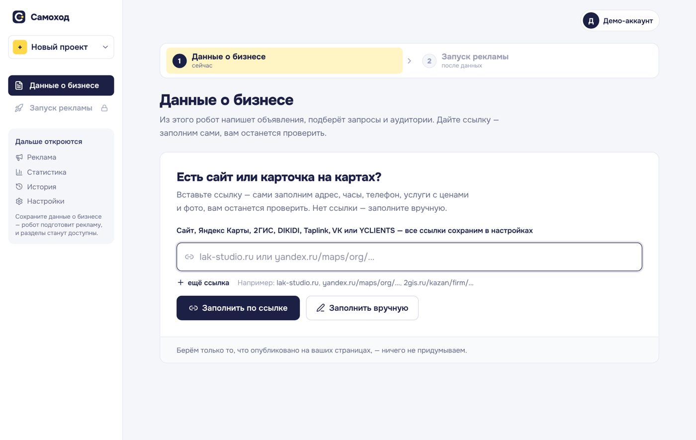
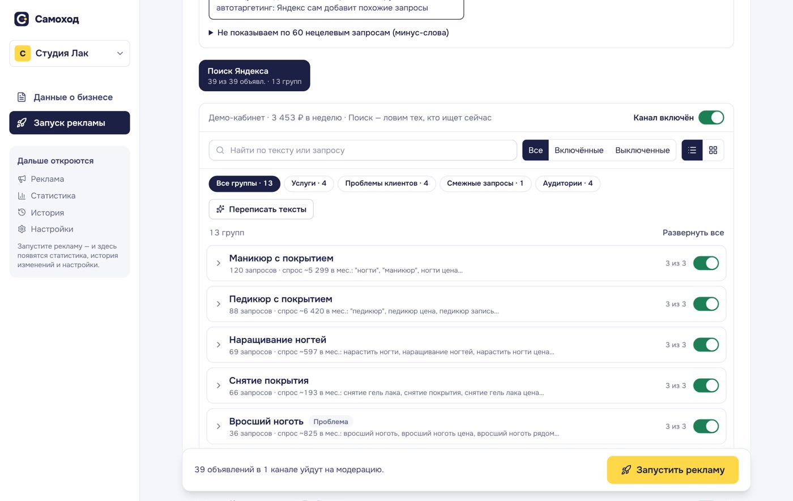
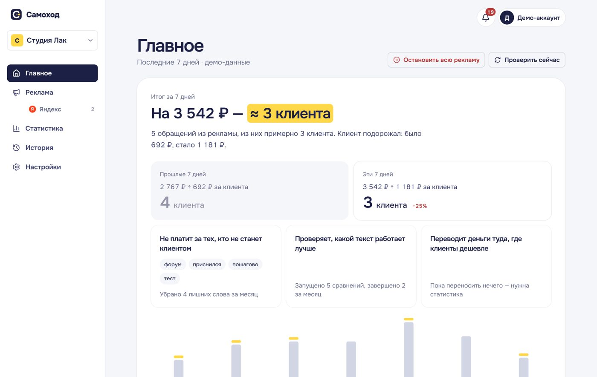
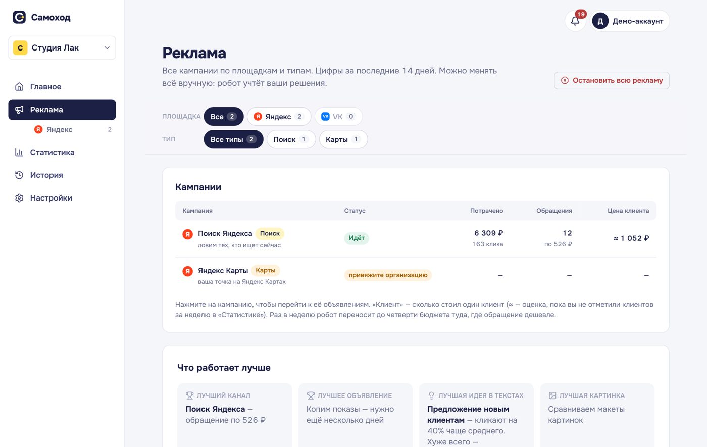
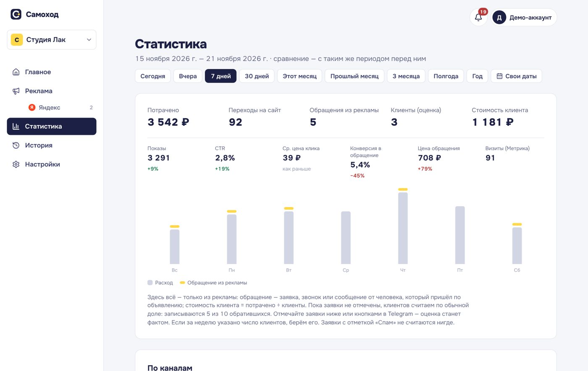
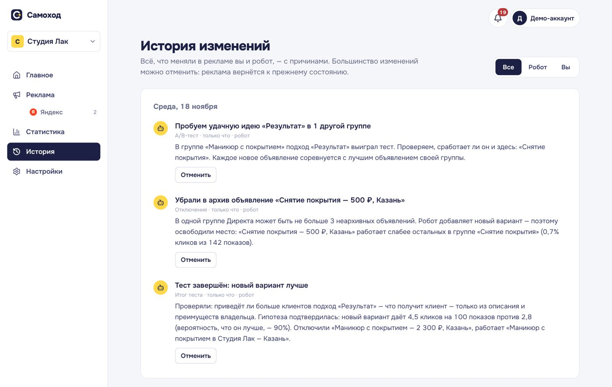
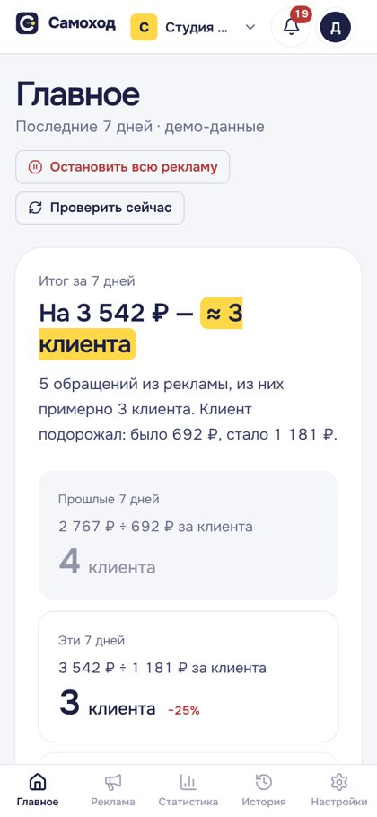

# Самоход

Сервис, который сам ведёт рекламу небольшого локального бизнеса: маникюрного салона, йога-студии, барбершопа, массажного кабинета. Раньше проект назывался «Полный зал» — это имя осталось в адресе прода, имени пакета и части документации.

Владелец рассказывает о бизнесе и выбирает месячный бюджет. Сервис сам запускает кампании в Яндекс Директе и VK Рекламе, каждый день проверяет результаты, отключает слабое, тестирует новое и объясняет каждое решение простыми словами — с кнопкой «Отменить».

**Прод:** https://81-26-176-249.sslip.io — Yandex Cloud, данные в РФ (152-ФЗ). Старый адрес https://polny-zal.vercel.app перенаправляет туда же. · **Передача проекта:** [docs/handover.md](docs/handover.md) · **Документация:** [архитектура](docs/architecture.md) · [деплой в РФ](docs/deploy-ru.md) · [исследование](docs/research.md) · [конкуренты](docs/competitors.md) · [интервью](docs/interviews.md)

### Ключевые возможности

- **Запуск в Яндекс Директе** — Единые перфоманс-кампании (ЕПК, API v5/v501) с комбинаторными объявлениями (`ResponsiveAd`): поиск, РСЯ, ретаргетинг. **VK Реклама** (API v2) — лента ВКонтакте и Одноклассников, ретаргетинг по пикселю.
- **Спрос и подбор фраз по Wordstat** через Yandex Cloud Search API v2 (`wordstat/topRequests`). Wordstat в API Директа v4 / Live 4 отключён (код ошибки 509) — этот путь оставлен в коде запасным, но на практике не работает.
- **Прогноз** обращений и цены обращения по спросу из Wordstat и допущениям по нишам (`engine/budget.ts`); без спроса — грубая оценка.
- **Тексты** — YandexGPT; без ключей Yandex Cloud — шаблоны по нишам. **Картинки** — YandexART и собственные макеты (рендер на сервере).
- **Ежедневный робот:** защита месячного бюджета, A/B-тесты объявлений и картинок, минус-слова, перенос бюджета между каналами, переписывание отклонённых объявлений, качество визитов из Метрики, исключение площадок РСЯ.
- **Модерация:** при открытии кабинета статусы проверяются заново (не чаще раза в 10 минут), на «Главном» — баннер «на модерации» / «не прошли модерацию».
- **Яндекс Метрика:** счётчик и цели, офлайн-конверсии «Записался», воронка по каналам «показы → клики → визиты → качественные визиты → обращения» на странице «Статистика».
- **Подключение сайта клиента:** одна строка кода трекера (`/t.js`) — автоматически ловит формы, клики по телефону, переходы в мессенджеры и онлайн-запись; инструкции для Tilda, WordPress, Wix, Taplink; кнопка «Проверить установку».
- **Страница записи** `/p/<key>` для бизнеса без сайта (можно встроить на сайт через iframe).
- **Telegram-уведомления:** заявки с кнопками статуса, утренняя сводка, предупреждение о кончающихся деньгах.
- **Анкета по ссылке:** сайт, Яндекс Карты, 2ГИС, Taplink, DIKIDI — адрес, часы, телефон, услуги и фото заполняются сами.
- **Демо-режим:** весь путь без настоящих кабинетов; показы и обращения моделируются, время можно промотать.
- **Отмена любого решения** — робота или владельца — одной кнопкой в «Истории» (и отмену тоже можно отменить).

### Как это выглядит

<p align="center"></p>

| Анкета: ссылка на сайт или карты — данные заполнятся сами | Мастер запуска: кабинеты, спрос, бюджет, объявления |
|---|---|
|  |  |
| **Главное:** сколько клиентов принесла реклама и что сделал робот | **Реклама:** кампании, статусы, что работает лучше |
|  |  |
| **Статистика:** расход, обращения, цена клиента по дням и каналам | **История:** каждое решение робота с причиной и кнопкой «Отменить» |
|  |  |

<p align="center"><br><sub>Мобильная версия. Скриншоты — демо-кабинет (`ALLOW_DEMO=true`), данные смоделированы.</sub></p>

---

## Содержание

1. [Быстрый старт локально](#1-быстрый-старт-локально)
2. [Деплой](#2-деплой) — [Yandex Cloud (прод)](#21-yandex-cloud-вм-так-работает-прод) · [Vercel (разработка, демо)](#22-vercel-разработка-и-демо)
3. [Переменные окружения](#3-переменные-окружения)
4. [Ключи и доступы](#4-ключи-и-доступы)
5. [Расписание робота](#5-расписание-робота)
6. [Как работает робот](#6-как-работает-робот)
7. [Безопасность](#7-безопасность)
8. [Эксплуатация (runbook)](#8-эксплуатация-runbook)
9. [CI и структура репозитория](#9-ci-и-структура-репозитория)
10. [Ограничения и что не проверено](#10-ограничения-и-что-не-проверено)
11. [Передача проекта](#11-передача-проекта)

---

## 1. Быстрый старт локально

Нужен **Node.js 22** (минимум 20; CI и Docker-образ — на 22). Postgres ставить не нужно.

```bash
npm ci
cp .env.example .env.local   # для демо можно ничего не менять
npm run dev                  # http://localhost:3000
```

- Без `DATABASE_URL` используется встроенная **PGlite**: данные лежат в `.data/pglite` (путь — `PGLITE_DIR`). Таблицы создаются при первом запросе.
- На странице входа — **«Войти в демо без регистрации»** (только при `ALLOW_DEMO=true` в `.env` — по умолчанию демо выключено, в продакшене его не задают). Или зарегистрируйтесь по почте и паролю — почтовый сервер не нужен. Чтобы видеть письма без SMTP: `SMTP_URL=json://` — они печатаются в консоль (`[mail:json] …`).
- В режиме `next dev` `APP_SECRET` не обязателен (используется отладочный ключ).

**Демо-сценарий за 3 минуты:**
1. Заполните анкету или возьмите пример («Студия Лак», Казань, маникюр).
2. Мастер запуска: «Подключить демо» → бюджет → «Подготовить объявления» → «Запустить рекламу».
3. На «Главном» — «Демо: промотать время» (+7 дней, можно несколько раз). Робот проверит рекламу за каждый день.
4. «История» — решения робота с объяснениями и отменой. «Реклама» — объявления, тесты, ручное управление. «Статистика» — каналы, воронка, обращения.

**Проверки** (те же, что в CI):

```bash
npm run typecheck       # tsc --noEmit
npm run check:schema    # схема Drizzle совпадает с SQL-миграцией
npm run test:importer   # разборщики анкеты по ссылке на сохранённых страницах
npm run build
```

---

## 2. Деплой

Прод работает на **одной виртуальной машине в Yandex Cloud**: приложение в Docker, PostgreSQL 17 в Docker на той же ВМ, HTTPS — Caddy, секреты — Lockbox, бэкапы — Object Storage. Все данные (база, заявки с телефонами) — в РФ. Vercel остался только как редирект со старого адреса.

### 2.1. Yandex Cloud, ВМ (так работает прод)

Всё ставят и обновляют скрипты из [`deploy/vm`](deploy/vm), руками ничего на ВМ делать не нужно. Пошагово, с объяснением каждого ресурса — [docs/deploy-ru.md → Вариант Б′](docs/deploy-ru.md#вариант-б-вм-под-ключ-cloud-init--lockbox-так-развёрнут-основной-сервис). Коротко:

1. **Сервисный аккаунт** с ролями на каталог: `lockbox.payloadViewer`, `storage.uploader`, `ai.languageModels.user`, `ai.imageGeneration.user`, `search-api.webSearch.user`.
2. **Бакет** Object Storage для бэкапов (приватный).
3. **Секрет Lockbox** — только настоящие секреты: `YANDEX_CLIENT_SECRET`, `YANDEX_LOGIN_CLIENT_SECRET`, `VK_ADS_CLIENT_SECRET`, `TELEGRAM_BOT_TOKEN`, `SMTP_URL` и т. п. `APP_SECRET`, `CRON_SECRET` и пароль базы генерируются на ВМ сами; ключ Yandex Cloud не нужен — GPT, ART и Wordstat работают от сервисного аккаунта ВМ.
4. **ВМ** Ubuntu 24.04 (2 vCPU 20 %, 4 ГБ, диск 20 ГБ, статический IP), сервисный аккаунт из п. 1, метаданные:

   | Ключ | Значение |
   |---|---|
   | `user-data` | содержимое [`deploy/vm/cloud-init.yaml`](deploy/vm/cloud-init.yaml) |
   | `lockbox-secret-id` | ID секрета Lockbox |
   | `backup-bucket` | имя бакета |
   | `app-env` | несекретные настройки строками `KEY=VALUE`: `YANDEX_CLIENT_ID`, `YANDEX_LOGIN_CLIENT_ID`, `YANDEX_CLOUD_FOLDER_ID`, `VK_ADS_CLIENT_ID`, при своём домене — `APP_URL` |

5. Через 10–15 минут сервис доступен на `https://<IP-через-дефисы>.sslip.io` (или на `APP_URL`). Добавьте этот адрес в Redirect URI OAuth-приложений ([раздел 4](#4-ключи-и-доступы)).

Дальше ВМ живёт сама: раз в 5 минут забирает `master` из GitHub и пересобирается, раз в час запускает робота, ночью делает бэкап в бакет ([раздел 5](#5-расписание-робота), [раздел 8](#8-эксплуатация-runbook)). Стоимость — около 2 000 ₽/мес (ВМ, диск, IP).

**Проверка:**
```bash
curl -s https://<адрес>/api/health                                         # {"ok":true,…}
curl -sI https://<адрес>/api/health | grep -i x-served-by                 # x-served-by: yc-vm
curl -s -o /dev/null -w '%{http_code}\n' https://<адрес>/api/cron/run      # 401 — без ключа не пускает
```

### 2.2. Vercel (разработка и демо)

~20 минут. Подходит для демо и разработки; для клиентов из РФ — только вариант 2.1 (данные на Vercel и Neon лежат за рубежом). Для демо достаточно шагов 1–5, ключи площадок добавляются позже.

> **Тариф.** Vercel Hobby — только для некоммерческого использования. Для работы с реальными клиентами нужен **Vercel Pro** (он же снимает ограничение cron «раз в сутки»). Neon Free (0,5 ГБ) хватит на старт; картинки хранятся в Postgres, поэтому место кончится примерно через несколько десятков клиентов.

1. **Репозиторий.** Форкните или загрузите проект в свой GitHub.
2. **Проект.** [vercel.com](https://vercel.com) → **Add New → Project** → выберите репозиторий. Framework Preset определится сам (Next.js), настройки сборки не меняйте.
3. **База — Neon.** В проекте: **Storage → Create Database → Neon** → регион (например, Frankfurt) → **Connect Project**. Vercel добавит `DATABASE_URL` (pooled-строку) сам. Можно и вручную: проект на [neon.tech](https://neon.tech) → pooled connection string → `DATABASE_URL`.
   - **Preview-деплои** не подключайте к продовой базе: создайте в Neon отдельную ветку (branch) и задайте её строку в `DATABASE_URL` только для окружения *Preview*. Иначе preview-сборка с новой миграцией изменит схему прода.
4. **Переменные.** **Settings → Environment Variables** (окружение *Production*):

   | Переменная | Значение |
   |---|---|
   | `APP_URL` | `https://<проект>.vercel.app` — без `/` в конце |
   | `APP_SECRET` | `openssl rand -hex 32` — **задать один раз и больше никогда не менять** |
   | `CRON_SECRET` | `openssl rand -hex 24` — Vercel **не** создаёт её сам |

   Остальные — по мере подключения интеграций ([раздел 4](#4-ключи-и-доступы)).
5. **Redeploy.** **Deployments → … → Redeploy**: переменные применяются только к новым деплоям.
6. **Проверка.** Откройте `https://<проект>.vercel.app/api/health` — должно быть `200` и `"ok": true`:

   ```bash
   curl -s https://<проект>.vercel.app/api/health | jq
   curl -s -o /dev/null -w '%{http_code}\n' https://<проект>.vercel.app/api/cron/run   # 401 — без ключа не пускает
   curl -s -H "Authorization: Bearer $CRON_SECRET" https://<проект>.vercel.app/api/cron/run   # {"processed":…,"total":…}
   ```

**Чек-лист после деплоя:**

- [ ] `/api/health` → `ok: true`, `db.ok: true`, `appSecretSet: true`, `cronSecretSet: true`.
- [ ] Демо-вход и демо-сценарий проходят.
- [ ] В `integrations` — `true` у всего, что вы настроили (Директ, VK, Yandex Cloud, Wordstat, почта, Telegram).
- [ ] Redirect URI в OAuth-приложениях Яндекса, VK и Google совпадают с `APP_URL`.
- [ ] Секреты GitHub Actions `APP_URL` и `CRON_SECRET` заданы, ручной запуск `optimizer` зелёный ([раздел 5](#5-расписание-робота)).
- [ ] Настроены бэкапы ([раздел 8](#бэкапы)) — секреты `DATABASE_URL` (direct-строка) и `BACKUP_PASSPHRASE`.
- [ ] Через сутки в `/api/health` поле `cron.at` свежее, `failed: 0`.

**Другие варианты хостинга.** Кроме ВМ из 2.1 — Yandex Cloud Managed PostgreSQL + Serverless Containers, пошагово в [docs/deploy-ru.md](docs/deploy-ru.md). В корне есть [`Dockerfile`](Dockerfile) (Node 22, порт из `PORT`, по умолчанию 8080):

```bash
docker build -t samohod .
docker run -p 8080:8080 --env-file .env samohod
# Docker Hub недоступен: --build-arg NODE_IMAGE=mirror.gcr.io/library/node:22-bookworm-slim
```

Вне Vercel за своим прокси задайте `TRUSTED_IP_HEADER` (например, `x-real-ip`), иначе лимиты «по IP» не применяются.

---

## 3. Переменные окружения

Полный список с комментариями — в [`.env.example`](.env.example) (он авторитетен). Ниже — сжато.

**Обязательные в продакшене**

| Переменная | Зачем | Важно |
|---|---|---|
| `DATABASE_URL` | Postgres (Neon — pooled-строка). Запасной вариант — `POSTGRES_URL` | Пусто → PGlite (только разработка и демо) |
| `APP_SECRET` | Подпись сессий и ключ шифрования токенов кабинетов, ≥ 16 символов (лучше 32+) | **Никогда не менять:** после смены сохранённые токены кабинетов не расшифруются, все сессии сбросятся. Без него ключ выводится из `DATABASE_URL` — тогда смена пароля базы ломает то же самое. Без него и без базы production-сборка не стартует (если не задан `ALLOW_INSECURE`) |
| `CRON_SECRET` | Ключ для `/api/cron/run` (`Authorization: Bearer …`) | Тот же секрет — в GitHub Actions |
| `APP_URL` | Адрес сервиса: OAuth-редиректы, ссылки в объявлениях, вебхук Telegram, код трекера | Без `/` в конце. Пусто → адрес Vercel или `localhost:3000` |

**Интеграции** (без них соответствующая функция выключена или работает на шаблонах)

| Переменные | Что включают |
|---|---|
| `YANDEX_CLIENT_ID`, `YANDEX_CLIENT_SECRET` | Подключение Директа и Метрики. `YANDEX_DIRECT_SANDBOX=true` — песочница. `YANDEX_DIRECT_VAT` (0.22) — НДС в недельных лимитах. `METRIKA_ATTRIBUTION` (`last`) |
| `YANDEX_CLOUD_API_KEY`, `YANDEX_CLOUD_FOLDER_ID` | YandexGPT, YandexART, Wordstat. `YANDEX_GPT_MODEL` (`yandexgpt/latest` или `yandexgpt-lite/latest`), `YANDEX_WORDSTAT_CLOUD=off` — отключить Wordstat |
| `VK_ADS_CLIENT_ID`, `VK_ADS_CLIENT_SECRET` | VK Реклама (Authorization Code). Тонкая настройка: `VK_ADS_PACKAGE_ID`, `VK_ADS_VAT`, `VK_GEO_RADIUS_M`, `VK_LOCAL_GEO`, `VK_PIXEL`, `VK_AGE_RESTRICTIONS` и др. |
| `SMTP_URL`, `MAIL_FROM` | Письма: подтверждение почты, восстановление пароля, вход по ссылке. Включает проверку почты перед подключением кабинетов |
| `TELEGRAM_BOT_TOKEN` | Уведомления. `TELEGRAM_BOT_USERNAME`, `TELEGRAM_API_URL` — по желанию |
| `GOOGLE_CLIENT_ID`, `GOOGLE_CLIENT_SECRET` | Кнопка «Войти через Google» |
| `YANDEX_LOGIN_CLIENT_ID`, `YANDEX_LOGIN_CLIENT_SECRET` | Кнопка «Войти через Яндекс» — отдельное OAuth-приложение (не то, что для Директа) |
| `DGIS_API_KEY`, `YANDEX_PLACES_API_KEY` | Запасной путь автозаполнения анкеты, если 2ГИС / Карты показали капчу |
| `YANDEX_GEOCODER_KEY`, `NOMINATIM_*` | Геокодирование адреса для показов VK в радиусе (без ключа — Nominatim) |
| `PG_CA_CERT`, `PG_POOL_MAX` | Свой CA для Postgres (Yandex Managed PostgreSQL), размер пула (5) |
| `YANDEX_CLOUD_METADATA_IAM=1` | YandexGPT / ART / Wordstat без API-ключа — IAM-токеном сервисного аккаунта ВМ (на ВМ из 2.1 ставится сам) |
| `YANDEX_ART_MODEL` | Модель YandexART; по умолчанию пробуется `yandex-art-2.0/latest`, затем `yandex-art/latest` (старая модель для новых каталогов закрыта — 403) |
| `LEGACY_ORIGINS` | Прежние адреса сервиса через запятую: с них принимаются заявки и запросы форм после переезда (на ВМ — `https://polny-zal.vercel.app`) |
| `LEGACY_DATABASE_URL` / `NEON_DATABASE_URL` | Строка старой базы: из неё выводится прежний ключ шифрования, если раньше `APP_SECRET` не был задан, — так токены кабинетов после переезда расшифровываются |

**Квоты на платные вызовы** (на пользователя в сутки по Москве; превышение → `429` с понятным текстом). Значения по умолчанию «обычный / демо»:

| Переменная | Что считает | По умолчанию |
|---|---|---|
| `QUOTA_COPY_DAY` | подготовка объявлений (YandexGPT) | 20 / 3 |
| `QUOTA_REWRITE_DAY` | «Переписать тексты», за порцию | 30 / 3 |
| `QUOTA_IMAGES_DAY` | порция картинок YandexART | 60 / 20 |
| `QUOTA_VARIANT_DAY` | новый вариант объявления | 60 / 5 |
| `QUOTA_DEMAND_DAY` | новый сбор спроса | 10 / 3 |
| `QUOTA_WORDSTAT_DAY` | фраз в Wordstat Yandex Cloud | 300 / 0 |
| `QUOTA_GLOBAL_AI_DAY`, `QUOTA_GLOBAL_WORDSTAT_DAY` | общий лимит на весь сервис — страховка счёта Yandex Cloud | 3000, 3000 |

Демо-лимиты переопределяются через `QUOTA_DEMO_<ВИД>_DAY`.

**Отладка и прочее:** `ALLOW_DEMO=true` (демо-вход и демо-кабинет; по умолчанию выключены — в продакшене не задавайте), `ALLOW_INSECURE` (production-сборка без секрета — только для показа демо), `TRUSTED_IP_HEADER`, `DEMAND_DEBUG=1` (сырые ответы сбора спроса, токены вычищены — включать только на время диагностики), `PGLITE_DIR`, переопределения адресов API (`YANDEX_DIRECT_API_URL`, `METRIKA_API_URL`, `VK_ADS_API_URL`, `YANDEX_WORDSTAT_URL` и др.) — для тестов и прокси.

---

## 4. Ключи и доступы

Во всех адресах `<APP_URL>` — ваш `APP_URL`. Для локальной разработки добавьте в OAuth-приложения второй адрес с `http://localhost:3000`.

### Яндекс OAuth-приложение (Директ + Метрика) → `YANDEX_CLIENT_ID`, `YANDEX_CLIENT_SECRET`

1. [oauth.yandex.ru](https://oauth.yandex.ru) → **Создать приложение** → тип **«Для авторизации пользователей»** (он позволяет указать свой Redirect URI).
2. **Платформы: «Веб-сервисы»** → Redirect URI: `<APP_URL>/api/connect/yandex/callback`.
3. **Доступ к данным:** `direct:api` (использование API Директа), `metrika:read`, `metrika:write` (сервис создаёт счётчик, цели и загружает офлайн-конверсии). Сервис не передаёт `scope` в запросе — токен получает ровно отмеченные права.
4. ClientID и Client secret → в переменные.

### Заявка на доступ к API Директа

Подаёт **только разработчик сервиса, один раз** на приложение — владельцам бизнеса ничего подавать не нужно, они просто подключают кабинет через OAuth.

1. Войдите в [direct.yandex.ru](https://direct.yandex.ru) тем же аккаунтом, что владеет OAuth-приложением (создайте кабинет, если его нет).
2. **Инструменты → API → «Получить доступ к API»** → примите соглашение.
3. **«Мои заявки» → «Новая заявка»** → выберите ClientID приложения → тип доступа **полный** (сервис создаёт и меняет кампании, не только читает) → опишите сервис («автоматическое управление рекламой малого бизнеса в собственных кабинетах владельцев») и **схему взаимодействия**: владелец подключает свой кабинет по OAuth → сервер сервиса вызывает API Директа v5/v501 (кампании, группы, объявления, отчёты) и Live v4 (баланс) от имени владельца → решения робота видны владельцу и отменяемы.
4. Рассмотрение — от часа до нескольких рабочих дней. До одобрения можно работать в песочнице: `YANDEX_DIRECT_SANDBOX=true`.

У подключаемого аккаунта должен быть кабинет Директа (принята оферта); данные для маркировки рекламодатель один раз заполняет в кабинете Директа.

### Yandex Cloud → `YANDEX_CLOUD_API_KEY`, `YANDEX_CLOUD_FOLDER_ID`

1. [console.yandex.cloud](https://console.yandex.cloud) → облако и каталог, платёжный аккаунт (есть стартовый грант). ID каталога (`b1g…`) → `YANDEX_CLOUD_FOLDER_ID`.
2. **Identity and Access Management → Сервисные аккаунты → Создать** с ролями на каталог:

   | Роль | Для чего |
   |---|---|
   | `ai.languageModels.user` | YandexGPT — тексты, переписывание, синонимы, минус-слова |
   | `ai.imageGeneration.user` | YandexART — картинки |
   | `search-api.webSearch.user` | Search API v2 → Wordstat (спрос по фразам) |

3. В сервисном аккаунте → **Создать API-ключ** с областями действия `yc.ai.languageModels.execute`, `yc.ai.imageGeneration.execute`, `yc.search-api.execute`. Секрет → `YANDEX_CLOUD_API_KEY` (заголовок `Authorization: Api-Key …`).

Без ключей: тексты из шаблонов ниш, без YandexART, спрос по Wordstat не собирается (прогноз — грубая оценка по нише).

**На ВМ из 2.1 API-ключ не нужен:** те же три роли выдаются сервисному аккаунту ВМ, сервис получает IAM-токен из метаданных (`YANDEX_CLOUD_METADATA_IAM=1`). Нужен только `YANDEX_CLOUD_FOLDER_ID` (в `app-env`).

### VK Реклама → `VK_ADS_CLIENT_ID`, `VK_ADS_CLIENT_SECRET`

1. В кабинете [ads.vk.com](https://ads.vk.com) заполните реквизиты (юрлицо — в «Бюджете», физлицо — в «Настройках»).
2. **Настройки → Доступ к API → «Запросить доступ к API»**. Появятся `client_id` и `client_secret` — **секрет показывается 10 минут**, сохраните сразу.
3. По умолчанию выдаётся Client Credentials — доступ только к своему кабинету. Чтобы владельцы подключали **свои** кабинеты, нужен **Authorization Code Grant**: выдаётся отдельно, пишите на `ads_api@vk.team`, укажите Redirect URI `<APP_URL>/api/connect/vk/callback`. Сервис запрашивает права `read_ads,create_ads`.
4. Пока Code Grant не получен, владелец может подключить свой кабинет по собственным ключам API («Настройки» → подключение VK «по ключам»).

Access-токен VK живёт сутки (сервис обновляет его по refresh-токену); на пару «приложение — пользователь» не больше 5 токенов, иначе VK отвечает 403.

### Почта → `SMTP_URL`, `MAIL_FROM`

Регистрация и вход по паролю работают и без почты. Почта нужна для подтверждения адреса, восстановления пароля и входа по ссылке. **С `SMTP_URL` включается проверка почты:** пользователь с неподтверждённым адресом не может подключить Telegram и рекламные кабинеты.

**Яндекс 360 / Яндекс Почта:**
1. Отдельный ящик, например `robot@ваш-домен.ru`.
2. В ящике: **Все настройки → Почтовые программы** → включите IMAP и «Пароли приложений и OAuth-токены».
3. [id.yandex.ru](https://id.yandex.ru) → **Безопасность → Пароли приложений → Почта** → скопируйте пароль (показывается один раз).
4. ```
   SMTP_URL=smtps://robot%40ваш-домен.ru:<пароль приложения>@smtp.yandex.ru:465
   MAIL_FROM="Самоход" <robot@ваш-домен.ru>
   ```
   `@` в логине кодируется как `%40`; отправитель должен совпадать с логином. Для своего домена настройте SPF и DKIM. Mail.ru — `smtp.mail.ru:465`, пароль из «Пароли для внешних приложений».

### Telegram-бот → `TELEGRAM_BOT_TOKEN`

1. [@BotFather](https://t.me/BotFather) → `/newbot` → токен → `TELEGRAM_BOT_TOKEN`.
2. Вебхук `<APP_URL>/api/notify/telegram` сервис ставит сам, если `APP_URL` начинается с `https://`. Локально (http) обновления забираются опросом.
3. Владелец подключает чат в «Настройках»: одноразовая ссылка на 15 минут, бот привязывает чат только после кнопки «Подключить».

Бот присылает заявки с кнопками «Записался / Не дозвонились / Спам», утреннюю сводку с кнопками «Отменить» и предупреждение, когда деньги в кабинете кончатся через ≤ 3 дня.

### Вход через Google (необязательно) → `GOOGLE_CLIENT_ID`, `GOOGLE_CLIENT_SECRET`

[console.cloud.google.com](https://console.cloud.google.com) → **Google Auth Platform** → Audience: External (опубликуйте приложение или добавьте Test users) → **Clients → Create client → Web application** → Authorized redirect URI `<APP_URL>/api/auth/google/callback`. Запрашиваются только `openid email profile`.

### Вход через Яндекс (необязательно) → `YANDEX_LOGIN_CLIENT_ID`, `YANDEX_LOGIN_CLIENT_SECRET`

[oauth.yandex.ru](https://oauth.yandex.ru) → **Создать** → «Для авторизации пользователей» → платформа «Веб-сервисы», Redirect URI `<APP_URL>/api/auth/yandex/callback` → права **«Доступ к адресу электронной почты»** (`login:email`) и **«Доступ к логину, имени и фамилии, полу»** (`login:info`). Это отдельное приложение: у приложения Директа таких прав нет, поэтому без своих ключей кнопка не показывается. После добавления переменных — передеплой.

---

## 5. Расписание робота

Робот запускается запросом `GET` (или `POST`) `/api/cron/run` с заголовком `Authorization: Bearer <CRON_SECRET>`.

**Прод (ВМ):** таймер systemd `polny-zal-cron` — каждый час в :17, запрос идёт на `127.0.0.1:8080` прямо на ВМ, `CRON_SECRET` с ВМ не уходит. Журнал: `journalctl -u polny-zal-cron`. Робот на ВМ запускается, только если есть метка `/opt/polny-zal/cutover` (ставится после переключения старого адреса) — чтобы старый и новый сервис не управляли одними кампаниями одновременно. GitHub Actions `optimizer` и `backup` после переезда **отключены** (Actions → workflow → Enable, если вернётесь на Vercel).

Для варианта на Vercel:

| Источник | Как часто | Настройка |
|---|---|---|
| **Vercel Cron** | раз в сутки: `0 6 * * *` (09:00 МСК), на Hobby время плавает в пределах часа | Уже в [`vercel.json`](vercel.json). Hobby не разрешает чаще раза в сутки; Vercel сам передаёт `CRON_SECRET` в заголовке |
| **GitHub Actions** | каждые 2 часа (`17 */2 * * *`) | [`optimizer.yml`](.github/workflows/optimizer.yml): **Settings → Secrets and variables → Actions** → `APP_URL`, `CRON_SECRET`. В логах — только HTTP-статус и счётчики `processed/total/failed`. GitHub запускает расписание с задержками и отключает его после 60 дней без активности в репозитории |
| **Вручную** | по необходимости | `Actions → optimizer → Run workflow`, или curl (ниже), или кнопка «Проверить сейчас» у владельца |

```bash
curl -H "Authorization: Bearer $CRON_SECRET" "$APP_URL/api/cron/run"           # сводка: processed, total, failed, ms
curl -H "Authorization: Bearer $CRON_SECRET" "$APP_URL/api/cron/run?debug=1"   # + журнал по бизнесам — не запускать в публичных логах
```

Чем чаще проверки, тем точнее робот держит месячный бюджет. Два прохода одновременно не столкнутся: на каждый бизнес берётся блокировка (таблица `jobs`).

---

## 6. Как работает робот

### Один проход (`/api/cron/run` → `engine/run.ts`)

1. Забирает нажатия кнопок Telegram (только без https-вебхука).
2. Перебирает бизнесы `active`, `launching`, `paused` — сначала тех, кого дольше не обрабатывали, по 3 параллельно, укладываясь в ~45 с. Не успевшие пойдут первыми в следующий раз. Брошенный посреди запуска бизнес (владелец закрыл вкладку) доводится до конца.
3. Для каждого бизнеса под блокировкой:
   1. **Синхронизация** (`sync.ts`): статистика за 30 дней по дням и объявлениям, статусы модерации, аукцион. Потерян доступ к кабинету (коды Директа 53/54/58/513, VK 401/403) — кабинет помечается «ошибка, переподключите».
   2. **Баланс** кабинетов (`balance.ts`, не чаще раза в 3 часа): ≤ 3 дней денег — баннер и сообщение в Telegram.
   3. **Метрика** (`metrica-sync.ts`, раз в сутки): визиты, отказы, глубина, достижения целей по дням × кампания × объявление × фраза; срезы по площадкам РСЯ и поисковым запросам.
   4. **Офлайн-конверсии**: заявки «Записался» за 21 день (с ClientID Метрики или `yclid`) пачкой в Метрику, цель `pz_booked`.
   5. **Оптимизация** (`optimizer.ts`, только у активных бизнесов) — шаги ниже.
4. Утренние сводки в Telegram, уборка (см. [безопасность](#7-безопасность)), запись итога прохода для `/api/health`.

### Шаги оптимизации (по порядку)

| Шаг | Что делает | Как часто |
|---|---|---|
| Бюджет | Подгоняет недельные лимиты под остаток месяца; при нехватке отключает наименее важный канал или ставит паузу заранее; 1-го числа возвращает лимиты | каждый проход |
| Ретаргетинг | Включает кампанию, когда аудитория «были, но не записались» наберёт 100 человек | каждый проход |
| Модерация | Переписывает отклонённые объявления с учётом причины отказа | каждый проход |
| Тесты | Итоги A/B: уверенность ≥ 90 % по кликабельности; по качеству визитов из Метрики — ≥ 60 переходов у каждого варианта и уверенность 95 %; через 21 день без победителя оставляет лучший | каждый проход |
| Перенос идей | Победивший подход тестирует в соседних группах | каждый проход |
| Место в выдаче | Поиск: ставит или снимает предел цены клика | раз в ~неделю |
| Фото владельца, объявления, картинки | Отключает явно слабые, запускает новые варианты (≤ 4 за проход, в группе всегда ≥ 2 рабочих) | каждый проход |
| Аудитории, слои поиска | Отключает аудиторию, где обращение вдвое дороже лучшей; сравнивает слои семантики | каждый проход / раз в 3,5 дня |
| Минус-слова | Разбирает поисковые запросы (правила ниши + YandexGPT + запросы с почти одними отказами по Метрике) | раз в ~3 дня |
| Ключевые фразы | Помечает слабые фразы по качеству визитов | раз в ~3 дня |
| Площадки РСЯ | Запрещает площадку: ≥ 30 кликов за 30 дней, 0 обращений, отказы ≥ 85 % (`ExcludedSites`, до 1000 на кампанию) | раз в ~3 дня |
| Стратегия | При ≥ 10 обращений в неделю переключает Директ с «кликов» на «заявки» | каждый проход |
| Бюджет каналов | Переносит часть бюджета из самого дорогого канала в самый дешёвый | раз в ~неделю |

Каждое действие — набор операций с обратными; любое изменение отменяется в «Истории». Объекты, которые владелец менял сам, робот не трогает 14 дней; кампанию, остановленную владельцем, не включает никогда. Пока кампания обучается (VK ~7 дней, Директ ~14), робот не переносит её бюджет и не меняет предел цены клика. Подробности — в [docs/architecture.md](docs/architecture.md#робот).

### Что робот делает при сбоях

- **Статистика не пришла хотя бы по одному кабинету** с работающими кампаниями → **безопасный режим**: защита бюджета только снижает лимиты и останавливает, а шаги, которые включают кампании или перекладывают деньги («ретаргетинг», «бюджет каналов»), пропускаются. В журнале: «Шаг … пропущен: статистика обновилась не по всем кабинетам».
- **Ошибка одного шага** не останавливает остальные; проход помечается неуспешным (`failed` в сводке), шаг повторится в следующий раз.
- **Сбой баланса, Метрики, офлайн-конверсий** — пишется в журнал и не мешает роботу. Без счётчика или прав Метрики шаги с качеством визитов пропускаются, причина видна на странице «Статистика».
- **Ошибка при применении набора операций** — уже выполненные операции набора откатываются.
- **Функцию прервали по таймауту** — блокировка бизнеса истекает сама через 4 минуты, запуск — через 75 с; недосозданные кампании при повторе удаляются и создаются заново.

---

## 7. Безопасность

- **Токены кабинетов** хранятся только зашифрованными: AES-256-GCM, ключ из `APP_SECRET` (`src/lib/crypto.ts`). Если `APP_SECRET` добавили позже, старые токены и сессии продолжают открываться прежним ключом (от `DATABASE_URL`).
- **Сессии** — HMAC-подписанная cookie `pz_session` (`httpOnly`, `SameSite=Lax`, `Secure` на https) с версией: смена пароля разлогинивает остальные устройства. Пароли — `scrypt` с солью.
- **CSRF:** все меняющие запросы проверяют `Origin` / `Sec-Fetch-Site` / `Referer` (`sameOrigin` в `src/lib/api.ts`); OAuth `state` проверяется во всех колбэках.
- **Заголовки** (`next.config.ts`): HSTS, `nosniff`, `Referrer-Policy`, `Permissions-Policy`, `X-Frame-Options: DENY` и `frame-ancestors 'none'`; исключение — страница записи `/p/*` (её можно встраивать).
- **Квоты на платные вызовы** YandexGPT / YandexART / Wordstat — на пользователя и общие на сервис (`useQuota` в `src/lib/ratelimit.ts`, [таблица выше](#3-переменные-окружения)). Счётчики в Postgres, поэтому работают на serverless.
- **Проверка почты:** при настроенном `SMTP_URL` нельзя подключить кабинеты и Telegram, пока адрес не подтверждён (`emailGate` в `src/lib/auth.ts`). Если владелец подтвердил почту, а пароль до этого задал кто-то другой, пароль стирается, а привязанные кабинеты и Telegram отвязываются.
- **Открытые эндпоинты** `/api/lead` и `/api/t`: лимиты по IP (хранится только отпечаток IP), одноразовый токен формы, подпись источника заявки (utm-метки подделать нельзя), пометка «похоже на спам».
- **Демо выключено по умолчанию:** вход без регистрации и тренировочный кабинет работают только при `ALLOW_DEMO=true`.
- **«Проверить сейчас»** (`/api/run`) — не чаще 6 раз за 10 минут на проект; запросы к API площадок, Метрики, Telegram и Yandex Cloud прерываются через 20–25 с.
- **SSRF:** импорт по ссылке и проверка сайта не ходят на внутренние адреса (IPv4 частные диапазоны, IPv6 ULA/link-local, `::/96`, `::ffff:0:0/96`, NAT64), проверяется и DNS-ответ.
- **Удаление проекта** берёт блокировку робота и не стирает данные, если хоть одну кампанию не удалось остановить.
- **`/api/cron/run`** — только с `Authorization: Bearer <CRON_SECRET>` (сравнение за постоянное время). Без `CRON_SECRET` на Vercel пускается только `vercel-cron` по User-Agent и не чаще раза в 30 минут, вне Vercel — `401`.
- **Уборка в каждом проходе cron:** демо-аккаунты старше **14 дней** удаляются со всеми данными; контакты в заявках старше 3 лет обезличиваются; история изменений — 2 года; `metrica_daily` — 400 дней; кэш Wordstat — 30 дней; неиспользуемые картинки.
- **Что не логируется и не отдаётся наружу:** `/api/health` без ключа — только `ok` и время; подробности (флаги интеграций, размер базы, последний крон) — с `Authorization: Bearer <CRON_SECRET>` или `?key=`; `/api/cron/run` без `?debug=1` — только счётчики (логи Actions публичного репозитория видны всем); в диагностике сбора спроса токены вычищаются; трекер `t.js` не читает значения полей форм; ошибки SMTP — только в серверном логе.
- **Где лежат данные:** база и приложение — на ВМ в Yandex Cloud (`ru-central1`). Порт базы наружу не открыт (только сеть Docker), снаружи доступны лишь 80/443 через Caddy. Вход на ВМ — OS Login (без SSH-ключей на диске), последовательная консоль выключена.
- **Секреты прода** — в Lockbox; на ВМ собираются в `/etc/polny-zal.env` (права 600, только root). `APP_SECRET`, `CRON_SECRET` и пароль базы созданы на ВМ и её не покидают.
- **Бэкапы:** на ВМ — в приватный бакет Object Storage (доступ только сервисному аккаунту); в варианте с GitHub Actions шифруются gpg до загрузки в артефакты (их может скачать любой вошедший в GitHub).

Подробнее — [docs/architecture.md → Безопасность](docs/architecture.md#безопасность).

---

## 8. Эксплуатация (runbook)

### Мониторинг: `/api/health`

Без входа; `200` — база отвечает и секрет настроен, иначе `503`. Подходит для UptimeRobot / healthchecks. Без ключа ответ — только `{"ok": true, "at": "…"}`; подробности ниже — с `Authorization: Bearer <CRON_SECRET>` (или `/api/health?key=<CRON_SECRET>`):

```json
{
  "ok": true,
  "db": { "ok": true, "ms": 42, "sizeMb": 31.5 },
  "secret": true, "appSecretSet": true, "cronSecretSet": true,
  "integrations": { "postgres": true, "google": false, "mail": true, "yandexDirect": true, "vk": false,
                    "yandexCloudAi": true, "wordstatCloud": true, "telegram": true },
  "cron": { "at": "2026-10-30T06:00:41Z", "processed": 12, "total": 12, "failed": 0, "ms": 31877 }
}
```

Следите за `cron.at` (на ВМ — не старше 2 часов), `failed`, `processed < total` (бизнесы не успевают за один проход — нужен более частый cron) и `db.sizeMb` (на ВМ диск 20 ГБ на всё, включая образы Docker). Поле `version` — коммит, который сейчас работает.

### Работа с ВМ

Вход: консоль Yandex Cloud → Compute Cloud → ВМ `polny-zal` → **Подключиться → Cloud Shell** (OS Login, ключи не нужны). Всё лежит в `/opt/polny-zal`:

| Путь | Что это |
|---|---|
| `app/` | код (git, ветка `master`), скрипты — `app/deploy/vm/*.sh` |
| `pgdata/` | данные PostgreSQL (контейнер `polny-zal-db`) |
| `backups/` | 3 последних дампа (остальное — в бакете) |
| `local.env`, `db.env` | `APP_SECRET`/`CRON_SECRET` и пароль базы — **не терять** (копия ключей есть только здесь) |
| `migrated`, `cutover` | метки: база перенесена с Neon; старый адрес переключён на ВМ |

```bash
systemctl list-timers 'polny-zal*'                           # расписание
journalctl -u polny-zal-deploy -n 50                         # обновления и сборка
journalctl -u polny-zal-cron -n 20                           # проходы робота
sudo docker logs --since 1h polny-zal                        # логи приложения
sudo systemctl start polny-zal-deploy                        # обновить сейчас, не дожидаясь 5 минут
sudo docker exec -it polny-zal-db psql -U polnyzal polnyzal  # база
```

### Бэкапы

**Прод (ВМ):** таймер `polny-zal-backup` каждую ночь в 01:30 делает `pg_dump` в бакет (`polnyzal-YYYYMMDD-HHMM.sql.gz`) и держит 3 последние копии на диске. Удаление старых копий в бакете — правилом жизненного цикла бакета. Восстановление в пустую базу:

```bash
gunzip -c polnyzal-….sql.gz | sudo docker exec -i polny-zal-db psql -U polnyzal polnyzal
```

**Вариант на Vercel:** [`backup.yml`](.github/workflows/backup.yml) — ночной `pg_dump -Fc`, зашифрованный gpg (AES256), в артефакт Actions на 7 дней. Секреты: `DATABASE_URL` (**direct**-строка Neon, не pooled — `pg_dump` не работает через PgBouncer) и `BACKUP_PASSPHRASE` (`openssl rand -base64 48`, храните отдельно — без неё бэкап не открыть). Ручной запуск: `Actions → backup → Run workflow`.

Восстановление:

```bash
gpg --batch --pinentry-mode loopback --passphrase "$BACKUP_PASSPHRASE" -d samohod-YYYYMMDD-HHMM.dump.gpg > db.dump
pg_restore --no-owner --clean --if-exists -d "$DATABASE_URL" db.dump
```

Версия `pg_dump` / `pg_restore` должна быть не старше сервера. Для восстановления без риска — в новую ветку Neon, затем переключите `DATABASE_URL`. **`APP_SECRET` должен остаться прежним**, иначе токены кабинетов из бэкапа не расшифруются.

### Миграции

- Схема — один идемпотентный SQL в `src/lib/db/migrate.ts` (`CREATE TABLE IF NOT EXISTS`, `ADD COLUMN IF NOT EXISTS`) и ORM-схема в `src/lib/db/schema.ts`.
- **Версия схемы** = отпечаток текста миграции (`SCHEMA_VERSION`), хранится в `kv` по ключу `schema:version`. При старте экземпляр сравнивает версию: совпала — DDL не выполняется; изменилась — миграция идёт один раз в транзакции под advisory-блокировкой (остальные экземпляры ждут), `lock_timeout` 5 с. Неудача — повтор при следующем запросе.
- **Добавить колонку:**
  1. В `schema.ts` — поле Drizzle.
  2. В конец `MIGRATION_SQL` — `ALTER TABLE <таблица> ADD COLUMN IF NOT EXISTS <колонка> <тип> [NOT NULL DEFAULT …];` (строго в этом формате — его ищет CI).
  3. `npm run check:schema` и `npm run typecheck`.
- Только добавляйте: не удаляйте и не переименовывайте колонки в той же версии, что и код, который перестал их использовать, — иначе откат релиза сломается.

### Типовые инциденты

| Симптом | Причина и что делать |
|---|---|
| Кабинет «ошибка доступа», в журнале коды 53/54/58/513 (Директ) или 401/403 (VK) | Токен истёк или отозван, кабинет отключён от API. Владелец переподключает кабинет в «Настройках». VK: при 403 проверьте лимит 5 токенов на пару «приложение — пользователь» |
| Баннер «деньги кончатся через N дней» / кампании «не показывается: нет денег» | Владелец пополняет кабинет Директа или VK; робот ничего не делает с деньгами сам. Остаток Директа берётся из Live v4 `AccountManagement` — если общий счёт не включён, остаток неизвестен |
| `/api/cron/run` → `401` | Неверный или отсутствующий `CRON_SECRET` в Actions / планировщике; сверить с переменной сервиса |
| `/api/cron/run` → `503` «CRON_SECRET не задан» | На Vercel переменная не создана — добавить и сделать Redeploy |
| `/api/health` → `503`, `secret: false` | Production-сборка без `APP_SECRET` и без базы. Задать `APP_SECRET`, Redeploy |
| `/api/health` → `503`, `db.ok: false` | База недоступна: проверить Neon (приостановка, лимит, смена пароля), `DATABASE_URL` |
| Объявления «не прошли модерацию» | Робот сам переписывает отклонённые с учётом причины (шаг «модерация»); владелец видит баннер и может поправить текст вручную. Медицинские ниши требуют лицензию в Директе |
| «Объект не найден» от Директа | Исторически — 19-значные ID Директа (больше 2^53) искажались при `JSON.parse`. **Исправлено:** длинные целые читаются строками и отправляются как BigInt (`src/lib/platforms/yandex.ts`). Если повторится — смотрите, не прошёл ли ID через `Number()` |
| Спрос не собирается, в диагностике код 509 | Wordstat в API Директа v4/Live отключён. Нужен Wordstat через Yandex Cloud: роль `search-api.webSearch.user` и область `yc.search-api.execute` у ключа |
| `429` у владельца | Исчерпана дневная квота (сообщение говорит какая); при необходимости поднять `QUOTA_*` |
| `processed < total` в сводке cron | Не хватает времени функции (~60 с) — запускать чаще (Actions каждые 2 часа, Vercel Pro) |
| ВМ: сайт не открывается | Cloud Shell → `sudo docker ps` (контейнеры `polny-zal`, `polny-zal-db`), `journalctl -u polny-zal-deploy -n 50`, `systemctl status caddy`. Новая сборка упала — продолжает работать прежняя версия, причина в журнале deploy |
| ВМ: изменения из GitHub не появились | `journalctl -u polny-zal-deploy`: сборка идёт ~1,5 мин, раз в 5 минут. `/api/health?key=…` → `version` показывает текущий коммит |
| ВМ: новый секрет из Lockbox не подхватился | Секреты перечитываются при каждом запуске deploy; значение длиной ≤ 8 символов или начинающееся с `-`, `TODO`, `ВСТАВ`, `ЗАПОЛН` считается заглушкой и пропускается. Пробелы и переводы строк по краям обрезаются |
| ВМ: `*.vercel.app` недоступен | Из облака в РФ адреса Vercel часто не открываются — поэтому проверка «старый адрес переключён» сделана меткой `/opt/polny-zal/cutover`, а не запросом |
| Перенос базы: «server version mismatch» | `pg_dump` должен быть не старше сервера: Neon уже на PostgreSQL 18, поэтому `migrate.sh` использует клиент 18 |

### Откат релиза

**Прод (ВМ):** ВМ всегда собирает последний коммит `master`. Откат — `git revert <коммит> && git push`: через 5–7 минут ВМ соберёт и запустит версию без него (или сразу: `sudo systemctl start polny-zal-deploy`). Образы прошлых версий остаются на ВМ, пока их не удалит `docker image prune`.

На Vercel: **Deployments** → предыдущий рабочий деплой → **… → Promote to Production** (Instant Rollback). Переменные окружения при этом не откатываются. Миграции аддитивные, поэтому старый код работает на новой схеме; при старте он заново применит свой (идемпотентный) SQL и запишет свою версию, а следующий релиз — свою. Если проблема в данных — восстановление из бэкапа (см. выше).

---

## 9. CI и структура репозитория

**CI** — [`ci.yml`](.github/workflows/ci.yml), на каждый push и pull request (Node 22): `npm ci` → `tsc --noEmit` → проверка схемы (колонки, добавленные через `ALTER TABLE … ADD COLUMN IF NOT EXISTS`, засчитываются) → `npm run test:importer` → `npm run build`. Другие workflow: [`optimizer.yml`](.github/workflows/optimizer.yml) (робот), [`backup.yml`](.github/workflows/backup.yml) (бэкап) — оба для варианта на Vercel и после переезда на ВМ отключены.

**Стек:** Next.js 16 (App Router, React 19, TypeScript), Tailwind CSS 4, PostgreSQL через Drizzle ORM (локально — PGlite), Satori (`next/og`) и sharp — рендер рекламных картинок, nodemailer.

```
src/
  app/
    app/              кабинет владельца: главное, реклама, статистика, история, настройки, анкета (start), мастер запуска (launch)
    p/[key]/          страница записи для бизнеса без сайта
    t.js/             скрипт-трекер для сайта владельца
    lp/, login/, reset/, verify/, privacy/   лендинг, вход, восстановление, подтверждение почты, политика
    api/              OAuth (auth, connect), запуск (launch), ручное управление, откат (changes), заявки (lead, t, leads),
                      Telegram (notify), сайт (site), модерация (moderation), cron/run, health
  components/         UI; SiteConnect.tsx — подключение сайта, ModerationCheck.tsx — проверка модерации
  lib/
    platforms/        yandex.ts (Директ), metrica.ts, vk.ts, wordstat-cloud.ts, demo.ts — общий интерфейс PlatformClient
    engine/           launch, run, sync, optimizer, ops (операции и откат), budget*, demand и wordstat (спрос),
                      metrica-sync и quality (визиты), site-tracking, balance, retarget, report, health
    ai/               YandexGPT и YandexART, тексты, минус-слова, шаблоны
    importer/         автозаполнение анкеты по ссылкам (с тестами на сохранённых страницах)
    creative/         макеты рекламных картинок
    db/               schema.ts, migrate.ts (SQL), index.ts (подключение, версия схемы)
    auth.ts, crypto.ts, ratelimit.ts, mail.ts, notify.ts, niches.ts
scripts/              check-schema.ts, render-samples.tsx
deploy/vm/            прод на ВМ Yandex Cloud: cloud-init, установка, обновление, перенос базы, робот, бэкап, таймеры systemd
deploy/vercel-proxy/  vercel.json, которым старый адрес на Vercel перенаправляет на ВМ
docs/                 документация (ниже)
```

**Документация:**

| Файл | О чём |
|---|---|
| [docs/architecture.md](docs/architecture.md) | Модули, модель данных, площадки и каналы, запуск, робот, отмена, автозаполнение, безопасность, заявки и баланс |
| [docs/ad-generation.md](docs/ad-generation.md) | Как готовятся объявления: тип бизнеса, группы от запроса, автор → проверка → жёсткие правила, расширения и выбор картинок |
| [docs/handover.md](docs/handover.md) | Передача проекта: где что лежит, доступы, что сменить новому владельцу, чек-лист |
| [docs/deploy-ru.md](docs/deploy-ru.md) | Развёртывание в Yandex Cloud (152-ФЗ): ВМ «под ключ» (прод), Managed PostgreSQL + Serverless Containers, расписание, перенос с Neon |
| [docs/research.md](docs/research.md) | Пользователь, возможности и ограничения площадок, почему решения робота такие, гипотезы |
| [docs/competitors.md](docs/competitors.md) | Конкуренты, сильные и слабые стороны, ценообразование |
| [docs/interviews.md](docs/interviews.md) | Гайд и план интервью с владельцами |

---

## 10. Ограничения и что не проверено

**Работает в проде:** Wordstat через Yandex Cloud Search API (сбор спроса, подбор фраз, прогноз). Весь путь сквозным прогоном проверен на демо-площадке: анкета, запуск, робот, откат и отмена отмены, бюджет, трекер, страница записи, креативы, статистика.

**Не работает:** Wordstat в API Директа v4 / Live 4 — отвечает кодом 509; код этого источника оставлен как запасной.

**Сделано по документации, на реальных аккаунтах не проверено:**
- **Поля Метрики** `ym:s:lastDirectClickOrder`, `lastDirectClickBanner`, `lastDirectPhraseOrCond`, `lastDirectPlatform`, `lastDirectSearchPhrase` — группировки отчёта по Директу; если их нет, используется запасной путь по UTM-меткам.
- **`ExcludedSites` в ЕПК** — запрет площадок РСЯ через `campaigns.update` для Единой перфоманс-кампании.
- **VK Реклама** целиком (кампании, форматы «пакетов», пиксель, ретаргетинг-сегменты, баланс `user.json → account.balance`). Authorization Code Grant для сервиса пока не получен — подключение VK по OAuth на проде не настроено, остаётся подключение по ключам.
- **Офлайн-конверсии** в Метрику, условие ретаргетинга Директа, НДС в лимитах Директа (лимит отправляется как бюджет / 1,22; если окажется иначе — `YANDEX_DIRECT_VAT=0`), ссылки «Открыть в кабинете».

**Известные ограничения:**
- **Бюджет — не жёсткая гарантия.** Площадки отдают расход с задержкой, а робот проверяет рекламу раз в час (ВМ). Запас заложен (2 дня трат × 1,3), но возможен небольшой перерасход в последние дни месяца.
- **Один сервер:** приложение и база на одной ВМ без резерва. Падение ВМ = простой до её перезапуска; данные защищены ночным бэкапом (потеря — до суток). При росте — Managed PostgreSQL и вторая ВМ или Serverless Containers ([docs/deploy-ru.md](docs/deploy-ru.md)).
- **Технический адрес** `*.sslip.io`: сертификат Let's Encrypt выпускается на IP; для клиентов лучше свой домен — задайте `APP_URL` в `app-env`, A-запись на IP ВМ и обновите Redirect URI.
- **Ссылки в уже запущенных объявлениях** ведут на `polny-zal.vercel.app/p/…`: Vercel проксирует их на ВМ, но адреса Vercel из части российских сетей открываются нестабильно, и телефоны из заявок проходят через Vercel. Новые кампании создаются уже со ссылками на ВМ; старые стоит перевести (смена ссылки отправляет объявления на повторную модерацию).
- **Звонки и мессенджеры** считаются как клики по номеру или ссылке, настоящего коллтрекинга нет; интеграции с YCLIENTS и DIKIDI нет — клиентов владелец отмечает сам.
- **Персональные данные** на проде хранятся в РФ (ВМ Yandex Cloud). Старая база Neon (за рубежом) после переезда ещё существует — удалите её, когда убедитесь, что всё перенесено ([docs/handover.md](docs/handover.md)).
- **Картинки хранятся в Postgres** (`bytea`) — на диске ВМ 20 ГБ это сотни клиентов, но следите за `db.sizeMb`.
- **Интервью с пользователями ещё не проведены** — план в [docs/interviews.md](docs/interviews.md).

---

## 11. Передача проекта

Полная опись — [docs/handover.md](docs/handover.md): какие аккаунты и ресурсы есть (GitHub, Yandex Cloud, OAuth-приложения Яндекса, Vercel, Neon), какие секреты новому владельцу нужно сменить и как, что удалить после переезда, и чек-лист приёмки.
